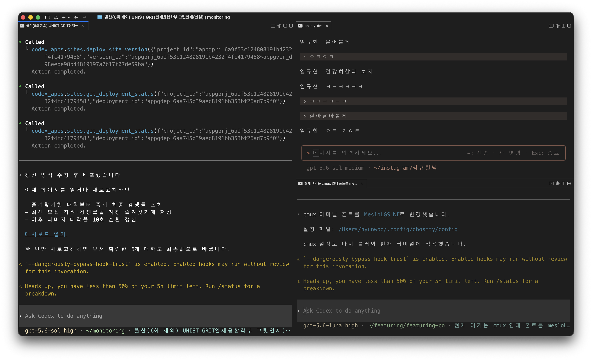

# oh-my-dm



[한국어](#한국어) · [English](#english)

## 한국어

**DM 하는 것처럼 보이지 않게 DM하세요.**

oh-my-dm은 Agent CLI처럼 보이도록 만든 눈치 덜 보이는 TUI 메신저입니다. Instagram, Telegram과 카카오톡을 Codex CLI, Claude Code, OpenCode 같은 도구에서 영감을 받은 인터페이스로 표시해, 주변 사람이 화면을 얼핏 봤을 때 열린 채팅 앱보다 코딩 에이전트 작업처럼 보이게 합니다.

핵심 목적은 회사, 교실 또는 사람이 함께 있는 공간에서 익숙한 메신저 창으로 시선을 끌지 않고 조금 더 사적으로 DM을 확인하고 보내는 것입니다. 터미널 작업 흐름을 유지하는 것은 추가 장점입니다. 별도 애플리케이션 백엔드나 메시지 저장소는 없으며, 로컬 connector가 원본 서비스의 데이터를 읽어 하나의 Agent 스타일 workspace에 표시합니다.

### 빠른 시작

Node.js 22 이상이 필요합니다. 설치 없이 최신 버전을 바로 실행할 수 있습니다.

```bash
# Instagram 최초 로그인
npx oh-my-dm@latest login instagram

# 실행
npx oh-my-dm@latest
```

로그인을 마치면 `Ctrl+C`로 로그인 창을 닫으세요. 카카오톡은 별도 로그인 없이 실행 중인 macOS 앱에 연결됩니다.

### 사용법

| 작업 | 입력 |
| --- | --- |
| 대화 목록 열기 | `/conversations` |
| Connector 전환 | `Tab` 또는 `←`/`→` |
| 대화 선택 및 열기 | `↑`/`↓`, `Enter` |
| 메시지 전송 | 메시지 입력 후 `Enter` |
| 이전 메시지 보기 | 빈 입력창에서 `↑` 또는 `PageUp` |
| 명령 목록 열기 | `/` |
| 종료 | `Esc`, `/exit` 또는 `Ctrl+C` |

### Telegram Web 연결

```bash
# 이 저장소에서 실행할 때
npm run dev -- login telegram
npm run dev
```

로그인 창의 Telegram WebK(`https://web.telegram.org/k/`)에서 QR 코드 또는 전화번호로 직접 로그인한 뒤 `Ctrl+C`로 종료하세요. TUI의 `/conversations`에서 `Tab` 또는 방향키로 Telegram 탭을 선택합니다. 설치된 CLI에서는 `oh-my-dm login telegram`과 `oh-my-dm logout telegram`을 사용합니다.

Telegram은 별도 `browser/telegram` 프로필을 사용합니다. 이 프로필이 있을 때만 TUI가 Telegram 커넥터를 시작하며, 처음에는 Telegram 탭에서 로그인 안내만 표시합니다. 로그인 창을 종료한 뒤 TUI를 실행하세요. 두 프로세스가 같은 프로필을 동시에 열 수는 없습니다. 대화 목록과 텍스트 송수신, 이전 메시지·추가 대화 로딩을 지원하며 화면을 1.5초마다 다시 읽습니다. 미디어는 화면에서 식별 가능한 종류만 텍스트로 표시하며 파일을 다운로드하지 않습니다. WebA(`/a/`), 포럼 토픽, 파일 전송은 지원하지 않습니다. 작성 중인 초안이나 답장·수정 창이 있으면 전송을 중단합니다.

프로필에는 Telegram의 로그인 정보와 웹앱 로컬 데이터가 포함될 수 있으므로 민감하게 취급하세요. 실제 계정의 로그인 및 송수신 확인은 별도로 필요합니다. 자동 테스트는 합성 화면을 사용합니다.

### 왜 oh-my-dm인가요?

- **메신저처럼 바로 보이지 않는 화면** — 익숙한 DM 창 대신 Agent CLI workspace 형태로 대화를 표시
- **주변 눈치를 덜 보는 메시징** — 주변 사람의 시선을 덜 끌며 DM을 확인하고 전송하도록 설계
- **터미널 작업 흐름에도 잘 맞는 UI** — Agent 스타일 transcript, command palette, 모델 표기, workspace 경로, 테마와 키보드 중심 탐색
- **DM을 위한 하나의 workspace** — Instagram과 카카오톡 대화를 통합된 TUI에서 탐색
- **로컬 우선·휘발성 구조** — oh-my-dm 서버와 영구 메시지 데이터베이스 없이 동작
- **실제 터미널 입력에 최적화** — 반응형 레이아웃, scrollback, history paging과 한글 IME 지원

### 주요 기능

- 개인 Instagram 계정으로 수동 로그인
- 터미널에서 대화 목록 조회와 텍스트 메시지 송수신
- 사진, 영상, 릴스, 게시물, 이모티콘, 공감, 답장, 수정, 삭제와 시스템 안내를 공통 메시지 타입으로 정규화
- 그룹 대화의 실제 발신자 이름 표시
- macOS 카카오톡 대화 목록·메시지 조회와 전송
- 하나의 통합 대화 목록 사용 및 `/connectors`에서 연결 상태 확인
- DOM과 WebSocket wake-up signal을 통한 event-driven 업데이트
- 로그인 세션만 전용 브라우저 프로필에 저장
- 대화와 메시지는 저장하지 않으며 connector를 원본 데이터 기준으로 사용
- 한국어 시스템에서는 한국어, 그 외에는 영어를 자동 사용하고 언제든 `/language`로 변경

oh-my-dm은 Instagram 내부 WebSocket이나 MQTT payload를 해석하지 않습니다. 수신 frame은 화면에 표시된 DOM을 다시 읽도록 깨우는 신호로만 사용합니다.

> [!NOTE]
> 현대적인 Agent CLI의 인터페이스에서 영감을 받았지만 OpenAI, Anthropic 또는 OpenCode와 공식적으로 연관되거나 보증받은 프로젝트는 아닙니다. 주변 시선을 줄이기 위한 인터페이스이며 회사 정책이나 기기 모니터링을 우회하는 도구는 아닙니다.

### 설치 및 설정

Node.js 22 이상이 필요합니다. Instagram connector는 전용 Playwright Chromium을 설치해 사용하므로 기본 브라우저가 Safari, Chrome, Brave 또는 다른 브라우저여도 동일하게 작동합니다. 카카오톡은 macOS용 앱이 설치되어 있고 로그인되어 있어야 합니다.

```bash
npm install --global oh-my-dm
oh-my-dm login instagram
oh-my-dm
```

npm이 `oh-my-dm` 설치 스크립트를 차단했다고 표시하면, 전용 Chromium을 내려받을 수 있도록 스크립트를 허용해 다시 설치하세요.

```bash
npm install --global --allow-scripts=oh-my-dm oh-my-dm
```

짧은 별칭인 `dm`도 함께 설치되므로 어느 경로에서든 `dm` 또는 `oh-my-dm`으로 같은 TUI를 실행할 수 있습니다.

`oh-my-dm`을 입력했는데 TUI가 실행되지 않고 같은 이름의 로컬 폴더로 이동한다면 현재 shell에 전역 명령이 설치되지 않은 상태입니다. 위 명령으로 설치한 뒤 새 터미널을 열거나 zsh에서 `rehash`를 실행하세요.

카카오톡을 사용하려면 oh-my-dm을 실행한 터미널 앱을 `시스템 설정 → 개인정보 보호 및 보안 → 손쉬운 사용`에서 허용하세요. 앱은 카카오톡 손쉬운 사용 UI에 불러온 채팅 내용만 읽으며, native bridge나 디스크에 대화와 메시지를 기록하지 않습니다.

Instagram 로그인은 열리는 전용 Playwright Chromium 창에서 직접 완료합니다. TUI는 같은 격리 프로필을 headless로 재사용하며 사용자의 기본 브라우저 프로필이나 쿠키에는 접근하지 않습니다. 기본 데이터 디렉터리는 `~/.oh-my-dm`입니다. 개발자는 `OH_MY_DM_BROWSER`로 Chromium 실행 파일을 변경하거나 별도의 데이터 디렉터리를 사용할 수 있습니다.

```bash
OH_MY_DM_DATA="$PWD/.oh-my-dm" npm run dev
```

일반 TUI는 번들된 Playwright Chromium을 headless로 사용합니다. 디버깅할 때만 브라우저 창을 표시하세요.

```bash
oh-my-dm chat --headed
oh-my-dm doctor
oh-my-dm logout instagram
```

### 플랫폼 및 콘텐츠 지원

| Connector | 지원 범위 | 참고 |
| --- | --- | --- |
| Instagram | macOS와 Linux에서 CI 검증 | 번들된 Playwright Chromium을 사용합니다. Windows는 아직 공식 검증되지 않았습니다. |
| 카카오톡 | macOS 전용 | 데스크톱 카카오톡 앱 로그인과 손쉬운 사용 권한이 필요합니다. |

텍스트 대화는 전체 내용을 표시합니다. 사진, 영상, 릴스, 게시물, 이모티콘, 공감, 답장, 수정, 삭제와 시스템 안내는 connector와 무관한 공통 메시지 타입으로 정규화하고, 원본 UI에서 확인할 수 있을 때 일관된 텍스트 표식으로 표시합니다. 공유 릴스는 Instagram이 제목을 제공하면 `제목(릴스)`, 제공하지 않으면 `(릴스)`로 표시합니다. 미디어 파일 자체는 다운로드하거나 렌더링하지 않으며, 원본 앱의 보이는 DOM이나 손쉬운 사용 트리에 노출되지 않은 콘텐츠는 생략될 수 있습니다.

`/model`에서 선택하는 모델 이름과 effort는 workspace를 꾸미는 시각적 표기일 뿐입니다. 실제 AI 모델에 연결하거나 대화 내용을 AI provider로 전송하지 않으며 connector 동작에도 영향을 주지 않습니다.

### 로컬 데이터 및 개인정보

oh-my-dm은 메시지를 저장하지 않지만 동작을 위해 일부 로컬 상태가 필요합니다.

- Instagram 전용 브라우저 프로필에는 로그인 cookie가 있으므로 민감한 정보로 취급해야 합니다.
- UI 언어, 테마와 모델 표기 설정은 로컬에 저장됩니다.
- `/clear`는 터미널 화면과 scrollback만 비우며 Instagram이나 카카오톡의 메시지를 삭제하지 않습니다.
- `oh-my-dm logout instagram`은 Instagram 전용 브라우저 프로필을 삭제해 이 CLI에서 로그아웃합니다. 다른 브라우저의 로그인에는 영향을 주지 않습니다.

`~/.oh-my-dm/browser`를 Git에 commit하거나 신뢰할 수 없는 위치에 공유·백업하지 마세요. 기존 로그인 세션을 잃지 않도록 이전 설치에서는 legacy 경로인 `~/.oh-my-chat`을 계속 사용할 수 있습니다.

### 언어

기본적으로 `LC_ALL`, `LC_MESSAGES`, `LANG`을 따라 UI 언어를 선택하며, 수동 선택은 로컬에 저장됩니다.

```text
/language auto
/language en
/language ko
```

### 슬래시 명령

`/`를 입력해 command palette를 엽니다. 방향키로 이동하고 `Tab`으로 자동 완성한 뒤 `Enter`로 실행합니다.

```text
/help
/open <대화방 이름>
/conversations
/unread
/all
/connectors
/history
/model
/theme
/language [auto|ko|en]
/refresh
/update
/clear
/exit
```

`/`로 시작하는 일반 메시지를 보내려면 `//message`처럼 slash를 두 번 입력하세요.

`/open`은 대화방 이름이 하나로 특정되어야 합니다. 표시 이름이 같은 대화방이 여러 개라면 `/conversations`에서 올바른 행을 직접 선택하세요. `/unread`와 `/all`은 대화 목록 filter만 변경하며 원본 서비스의 읽음 상태는 바꾸지 않습니다.

### 업데이트 및 제거

```bash
oh-my-dm update
oh-my-dm doctor
```

새 버전이 있으면 입력창 위에 `Update available`을 표시하고 백그라운드에서 자동으로 설치합니다. 설치가 끝나면 `Update installed · Restart to update`로 바뀌며, 현재 채팅을 강제로 종료하지 않고 다음 실행부터 새 버전이 적용됩니다. `/update`를 실행해 수동으로 설치할 수도 있습니다. 자동 설치를 끄려면 `OH_MY_DM_NO_AUTO_UPDATE=1`을 설정하세요. 업데이트 확인이나 자동 설치가 실패해도 TUI 실행을 막지 않으며 `/update`로 다시 시도할 수 있습니다.

CLI를 제거하려면 필요에 따라 Instagram 세션을 먼저 삭제한 뒤 package를 제거하세요.

```bash
oh-my-dm logout instagram
npm uninstall --global oh-my-dm
```

### 문제 해결

| 증상 | 해결 방법 |
| --- | --- |
| `oh-my-dm`을 찾지 못하거나 같은 이름의 폴더로 이동함 | 전역으로 다시 설치하고 새 터미널을 열거나 zsh에서 `rehash`를 실행하세요. `command -v oh-my-dm`으로 확인할 수 있습니다. |
| npm이 install script를 차단함 | `npm install --global --allow-scripts=oh-my-dm oh-my-dm`으로 다시 설치하세요. 이 script는 Ink를 patch하고 전용 Chromium을 다운로드합니다. |
| Instagram 로그인이 필요하다고 나오거나 대화방이 나타나지 않음 | `oh-my-dm login instagram`을 다시 실행하세요. 세션이 손상됐다면 `oh-my-dm logout instagram` 후 다시 로그인하세요. |
| Chromium을 찾을 수 없음 | `oh-my-dm doctor`로 확인한 뒤 install script를 허용해 다시 설치하세요. |
| 카카오톡 연결·대화방 열기·전송이 되지 않음 | 앱 설치와 로그인을 확인하고, oh-my-dm을 실행하는 정확한 터미널 앱에 손쉬운 사용 권한을 부여한 뒤 카카오톡과 터미널을 모두 재시작하세요. |
| Connector 내용이 갱신되지 않음 | `/refresh`를 실행하세요. Instagram이나 카카오톡 UI가 바뀐 경우에는 oh-my-dm 업데이트가 필요할 수 있습니다. |
| 터미널이 좁거나 행이 잘림 | 터미널 창을 넓혀주세요. 반응형 layout을 사용하지만 매우 작은 터미널에서는 일부 hint와 preview를 표시할 수 없습니다. |

### 주의

Instagram DOM selector와 카카오톡 손쉬운 사용 UI 구조는 예고 없이 변경되어 connector가 깨질 수 있습니다. Instagram은 허가받지 않은 자동 데이터 수집도 제한합니다. 개인 실험 용도로 보수적으로 사용하세요. 대량 전송, 자동 재시도와 우회 기능은 의도적으로 포함하지 않습니다.

### 기여 및 릴리스

Pull request를 열기 전에 [CONTRIBUTING.md](CONTRIBUTING.md)를 읽어주세요. 이 프로젝트는 Conventional Commits, 자동 검사와 Release Please를 사용합니다. 보안 문제는 공개 issue 대신 [SECURITY.md](SECURITY.md)의 절차에 따라 제보해주세요.

### 라이선스

[Apache License 2.0](LICENSE)

## English

**DM without looking like you're DMing.**

oh-my-dm is a discreet TUI messenger styled to look like an Agent CLI. It brings Instagram, Telegram, and KakaoTalk into an interface inspired by tools such as Codex CLI, Claude Code, and OpenCode, making casual screen glances look more like coding-agent work than an open chat app.

The main goal is simple: let you check and send DMs more privately in shared offices, classrooms, or other places where a familiar messenger window would immediately draw attention. Staying inside your terminal workflow is an additional benefit. There is no application backend or message archive; local connectors read from the original services and present everything through one agent-style workspace.

### Quick start

Requires Node.js 22 or later. Run the latest version directly without a global installation.

```bash
# First-time Instagram login
npx oh-my-dm@latest login instagram

# Launch
npx oh-my-dm@latest
```

After signing in, press `Ctrl+C` to close the login window. KakaoTalk connects to the running macOS app without a separate oh-my-dm login.

### Usage

| Action | Input |
| --- | --- |
| Open conversations | `/conversations` |
| Switch connectors | `Tab` or `←`/`→` |
| Select and open a conversation | `↑`/`↓`, `Enter` |
| Send a message | Type a message, then `Enter` |
| View older messages | `↑` or `PageUp` with an empty composer |
| Open command palette | `/` |
| Exit | `Esc`, `/exit`, or `Ctrl+C` |

### Connect Telegram Web

```bash
# When running from this repository
npm run dev -- login telegram
npm run dev
```

Sign in manually with a QR code or phone number in Telegram WebK (`https://web.telegram.org/k/`), then press `Ctrl+C` to close the login process. Open `/conversations` and select Telegram with `Tab` or the arrow keys. With an installed CLI, use `oh-my-dm login telegram` and `oh-my-dm logout telegram`.

Telegram uses a separate `browser/telegram` profile. The TUI starts the Telegram connector only when that profile exists; otherwise the Telegram tab shows login instructions. Close the login process before starting the TUI; two processes cannot open the same profile simultaneously. The connector supports conversation discovery, text messaging, older messages, and additional conversation loading, reading the DOM every 1.5 seconds. Recognizable media types appear as text markers without downloading files. WebA (`/a/`), forum topics, and file uploads are unsupported. An existing draft or reply/edit context blocks sending.

Treat the profile as sensitive: it can contain Telegram authentication and web-app local data. Login and messaging with a real account still require manual validation. Automated tests use synthetic pages.

### Why oh-my-dm?

- **Doesn't immediately look like a messenger** — conversations are presented as an Agent CLI workspace instead of a familiar DM window
- **Designed for discreet messaging** — check and send DMs with less visual attention from people around you
- **Also fits your terminal workflow** — use an agent-style transcript, command palette, model label, workspace path, themes, and keyboard-first navigation
- **One workspace for DMs** — browse Instagram and KakaoTalk conversations through a unified TUI
- **Local-first and ephemeral** — no oh-my-dm server and no persisted message database
- **Built for real terminal input** — responsive layouts, scrollback, history paging, and Korean IME support

### Features

- Sign in manually with a personal Instagram account
- Browse conversations and exchange text messages from the terminal
- Normalize photos, videos, Reels, posts, stickers, reactions, replies, edits, deletions, and system notices into shared message types
- See actual sender names in group conversations
- Browse and send KakaoTalk messages on macOS
- Use one unified conversation list and inspect connections with `/connectors`
- Receive event-driven updates through DOM and WebSocket wake-up signals
- Keep only the login session in a dedicated browser profile
- Never persist conversations or messages; connectors remain the source of truth
- Automatically use Korean on Korean systems and English elsewhere
- Change the interface language at any time with `/language`

oh-my-dm does not decode Instagram's internal WebSocket or MQTT payloads. Incoming frames are used only as wake-up signals to read the visible DOM again.

> [!NOTE]
> The interface is inspired by modern Agent CLI tools, but oh-my-dm is not affiliated with or endorsed by OpenAI, Anthropic, or OpenCode. It is a privacy-oriented interface, not a tool for bypassing workplace policies or device monitoring.

### Installation and setup

Node.js 22 or later is required. The Instagram connector installs and uses its own Playwright Chromium, so it works independently of whether your default browser is Safari, Chrome, Brave, or another browser. KakaoTalk additionally requires macOS with KakaoTalk installed and signed in.

```bash
npm install --global oh-my-dm
oh-my-dm login instagram
oh-my-dm
```

If npm reports that the `oh-my-dm` install script was blocked, allow it and reinstall so the dedicated Chromium can be downloaded:

```bash
npm install --global --allow-scripts=oh-my-dm oh-my-dm
```

`dm` is installed as a shorter alias, so you can launch the same TUI from any directory with either `dm` or `oh-my-dm`.

If typing `oh-my-dm` changes into a local directory with that name instead of launching the TUI, the global command is not installed in the current shell. Install it with the command above, then open a new terminal or run `rehash` in zsh.

For KakaoTalk, grant Accessibility permission to the terminal running oh-my-dm under `System Settings → Privacy & Security → Accessibility`. The app reads only chat content loaded in KakaoTalk's accessibility UI. Conversations and messages are not written to the native bridge or disk.

Instagram login is completed manually in the dedicated Playwright Chromium window that opens. The same isolated profile is reused headlessly by the TUI; your default browser profile and cookies are never accessed. The default data directory is `~/.oh-my-dm`. Developers can override the Chromium executable with `OH_MY_DM_BROWSER`, or use an isolated data directory:

```bash
OH_MY_DM_DATA="$PWD/.oh-my-dm" npm run dev
```

The regular TUI runs the bundled Playwright Chromium headlessly. Use a visible browser only for debugging:

```bash
oh-my-dm chat --headed
oh-my-dm doctor
oh-my-dm logout instagram
```

### Platform and content support

| Connector | Support | Notes |
| --- | --- | --- |
| Instagram | macOS and Linux are CI-tested | Uses the bundled Playwright Chromium. Windows is not yet officially verified. |
| KakaoTalk | macOS only | Requires the desktop KakaoTalk app, an active login, and Accessibility permission. |

Text conversations are fully rendered. Photos, videos, Reels, posts, stickers, reactions, replies, edits, deletions, and system notices are normalized into connector-independent message types and shown with consistent text markers when the source UI exposes them. Shared Reels use `title(릴스)` when Instagram provides a title, or `(릴스)` otherwise. Media files themselves are not downloaded or rendered, and content hidden from the source app's visible DOM or accessibility tree may still be omitted.

The model name and effort selected with `/model` are visual workspace labels only. They do not connect an AI model, send conversation content to an AI provider, or change connector behavior.

### Local data and privacy

Messages are not saved by oh-my-dm, but a small amount of local state is required:

- The dedicated Instagram browser profile contains login cookies and must be treated as sensitive.
- UI language, theme, and model-label preferences are saved locally.
- `/clear` clears only the terminal view and scrollback. It does not delete messages from Instagram or KakaoTalk.
- `oh-my-dm logout instagram` deletes the dedicated Instagram browser profile and signs this CLI out. It does not affect sessions in your other browsers.

Do not commit, share, or back up `~/.oh-my-dm/browser` to an untrusted location. Older installations may continue using the legacy `~/.oh-my-chat` directory so existing login sessions are not lost.

### Language

The interface follows `LC_ALL`, `LC_MESSAGES`, or `LANG` by default. A manual choice is saved locally.

```text
/language auto
/language en
/language ko
```

### Slash commands

Type `/` to open the command palette. Navigate with arrow keys, press `Tab` to autocomplete, and press `Enter` to run a command.

```text
/help
/open <conversation name>
/conversations
/unread
/all
/connectors
/history
/model
/theme
/language [auto|ko|en]
/refresh
/update
/clear
/exit
```

To send a regular message beginning with `/`, type it with two slashes, such as `//message`.

`/open` requires a unique conversation-name match. If several conversations have the same display name, use `/conversations` and select the correct row instead. `/unread` and `/all` change the conversation-list filter; they do not alter read state on the original service.

### Update and uninstall

```bash
oh-my-dm update
oh-my-dm doctor
```

When a newer version is available, the composer shows `Update available` and installs it automatically in the background. Once installation finishes, the notice changes to `Update installed · Restart to update`; the current chat stays open and the new version takes effect on the next launch. You can also run `/update` to install manually. Set `OH_MY_DM_NO_AUTO_UPDATE=1` to disable automatic installation. A failed check or background installation never prevents the TUI from starting, and `/update` can retry it.

To remove the CLI, optionally delete its Instagram session first and then uninstall the package:

```bash
oh-my-dm logout instagram
npm uninstall --global oh-my-dm
```

### Troubleshooting

| Symptom | What to do |
| --- | --- |
| `oh-my-dm` is not found or opens a same-named directory | Reinstall globally, open a new terminal, or run `rehash` in zsh. Confirm with `command -v oh-my-dm`. |
| npm blocks the install script | Reinstall with `npm install --global --allow-scripts=oh-my-dm oh-my-dm`. The script patches Ink and downloads the dedicated Chromium. |
| Instagram asks for login or conversations never appear | Run `oh-my-dm login instagram` again. If the session is corrupted, run `oh-my-dm logout instagram` and log in again. |
| Chromium cannot be found | Run `oh-my-dm doctor`, then reinstall with install scripts allowed. |
| KakaoTalk does not connect, open a room, or send | Confirm the app is installed and signed in, grant Accessibility to the exact terminal app running oh-my-dm, then restart both KakaoTalk and the terminal. |
| A connector looks stale | Run `/refresh`. Instagram and KakaoTalk UI changes can still require an oh-my-dm update. |
| The terminal is too narrow or rows look clipped | Enlarge the terminal window. The layout is responsive, but very small terminals cannot show every hint or preview. |

### Important

Instagram DOM selectors and KakaoTalk accessibility UI structures can change without notice and may break the connectors. Instagram also restricts unauthorized automated data collection. Use this project conservatively for personal experimentation. Bulk messaging, automatic retries, and bypass mechanisms are intentionally excluded.

### Contributing and releases

Read [CONTRIBUTING.md](CONTRIBUTING.md) before opening a pull request. This project uses Conventional Commits, automated checks, and Release Please. Security reports should follow [SECURITY.md](SECURITY.md), not public issues.

### License

[Apache License 2.0](LICENSE)
